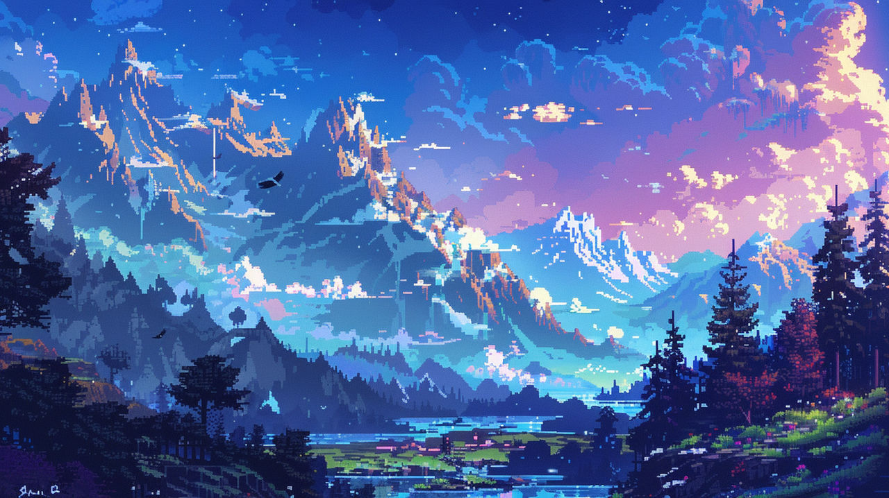

 

<h3 align="center">WELCOME TO MY CORNER OF THE INTERNET.</h3>

A WORLD OF IDEAS AND CURIOSITY.

 

 

<h3>[ PLAYER PROFILE ]</h3>

<h3>HELLO, WORLD!</h3>

I explore technology, mathematics,  
science and imagination.  
I question, create and build.  
No fixed direction. Just curiosity.

 

<h3>THE WORLD IS MY SANDBOX.</h3>

 

<h3> &gt;&gt; MY PROJECTS</h3>

Things I've built along the way.

<!-- ADD YOUR PROJECTS MANUALLY -->

| PROJECT | DESCRIPTION |
|:---|:---|
| [➜ Project One](YOUR_PROJECT_LINK_1) | Your description |
| [➜ Project Two](YOUR_PROJECT_LINK_2) | Your description |
| [➜ Project Three](YOUR_PROJECT_LINK_3) | Your description |
| [➜ Project Four](YOUR_PROJECT_LINK_4) | Your description |
| [➜ Project Five](YOUR_PROJECT_LINK_5) | Your description |

<h4>MORE WORLDS TO DISCOVER...</h4>

 

<h3>&gt;&gt; GITHUB STATS</h3>

 

 

 

<h3>&gt;&gt; ACTIVITY MAP</h3>

 

<h3>&gt;&gt; NEXT DESTINATION</h3>

 

 

<h4>THANKS FOR VISITING!</h4>

THEONEOUTLIER // LEVEL ∞ // STILL EXPLORING

